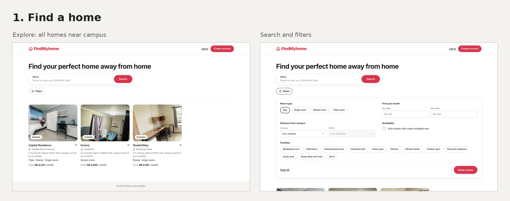
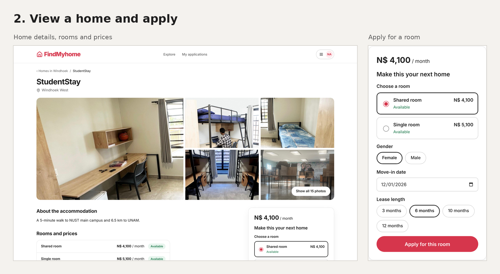
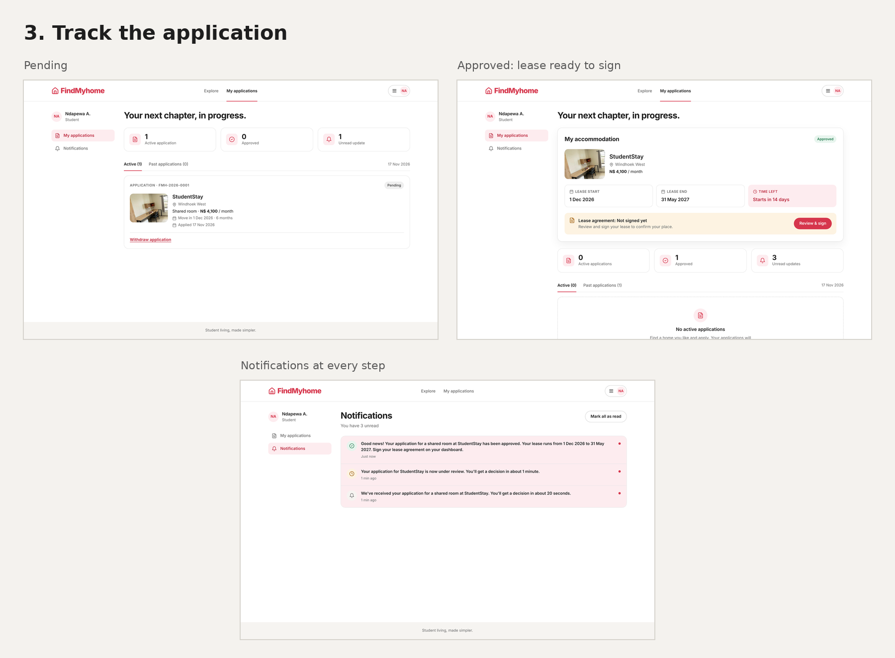
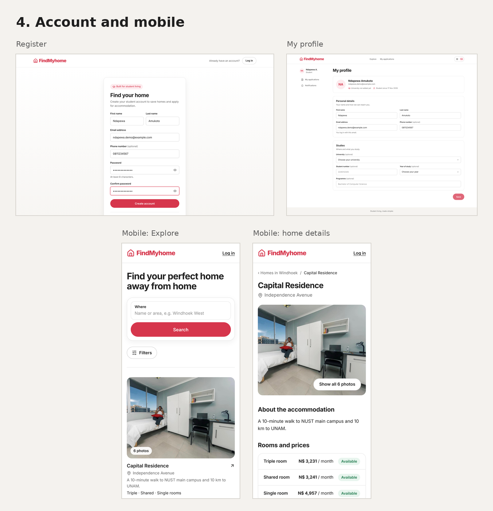

# FindMyhome: Student Accommodation System

A web app where students find accommodation near campus, apply for a room and track their application. Applications are reviewed automatically by the system.

**Stack:** React 19 + Vite (frontend) · Node.js + Express 5 (backend API) · PostgreSQL · Cloudinary (images) · JWT + bcrypt (authentication)

## The problem it solves

Finding a place to live is one of the first hurdles for a student at NUST or UNAM, and it is usually handled badly:

- **Hard to find and compare.** Listings are scattered across word of mouth, notice boards and social media, with no single place to compare price, room type, facilities and distance from campus.
- **Unclear availability.** Students often turn up or phone around only to learn the room they wanted is already taken.
- **Slow, opaque applications.** Applying means chasing landlords by phone or message, and students are left guessing whether their application was received, is being looked at, or was turned down.
- **Double bookings and disputes.** Without a shared record, the same room can be promised twice, and lease dates and terms are easy to dispute later.

FindMyhome puts this in one place:

| Problem | How FindMyhome handles it |
|---|---|
| Scattered listings | One Explore page with every home, its rooms, prices, facilities, rules, contact details and photos |
| Hard to compare | Search and filter by area, price, room type, availability, facilities and distance from NUST or UNAM |
| Unclear availability | Students can only apply for a room type that still has space |
| No feedback after applying | A clear status (Pending → Under Review → Approved or Rejected) with a notification at every step |
| Slow manual review | The server decides automatically using fixed rules, so there is no waiting on a person, and a rejection comes with the reason |
| Double bookings | An application is approved only if that room type still has space and the student has no other approved lease for overlapping dates |
| Lease confusion | The chosen move-in date and lease length (3, 6, 10 or 12 months) fix the lease start and end dates, and the student signs it on their dashboard |

## Live deployment

| What | URL |
|---|---|
| Full-stack app | https://findmyhome-web-production.up.railway.app |
| Source code | https://github.com/justy2305/student-accommodation-system |

The web service serves the React app and forwards every `/api/...` request to the API, so the login cookie stays on one site.
Easiest way to try the API from a browser or Postman: https://findmyhome-web-production.up.railway.app/api/accommodations

## Screenshots

**1. Find a home:** the Explore page and the search filters.



**2. View a home and apply:** home details, rooms and prices, and the apply card.



**3. Track the application:** pending, approved with the lease ready to sign, and the notifications.



**4. Account and mobile:** registration, profile, and the mobile layout.



## How it works

1. **Register** and log in.
2. **Search** homes on Explore by area, price, room type, availability, facilities and distance from campus.
3. **View** a home's details, rooms and prices, facilities, rules, contact details and photos.
4. **Apply** for a room type that has space, choosing your gender (Female or Male), a move-in date (up to 6 months ahead) and a lease length of 3, 6, 10 or 12 months.
5. **Track** the application: Pending → Under Review (after 1 minute) → a decision (after 2 minutes), with a notification at each step. The timing can be changed with `APPLICATION_REVIEW_SECONDS` (default 120 seconds).
6. **Decision:** approved if that room type still has space and the student has no other approved lease for overlapping dates; otherwise rejected, with the reason. When approved, the lease runs from the chosen move-in date for the chosen length (e.g. 1 Dec 2026 for 12 months ends 30 Nov 2027), and the student signs it on the dashboard.
7. A student can withdraw an application while it is Pending or Under Review.

## Project structure

```
Backend/    Express REST API: auth, homes (read-only), applications, automatic review, notifications, profile
Frontend/   React app: Explore, home details, login and registration, dashboard, notifications, profile
```

Homes, room types, facilities, distances and photos come from `Backend/scripts/seed-accommodations.js`.

## Running it locally

**You need:** Node.js 22.12 or newer, PostgreSQL 14 or newer, and git.

```bash
git clone https://github.com/justy2305/student-accommodation-system.git
cd student-accommodation-system
```

Create the database first if it does not exist, for example `createdb findmyhome` (use the same name as `DB_NAME` below).

**1. Backend** (port 5000)

```bash
cd Backend
npm install
cp .env.example .env   # then fill in the values in the table below
npm run db:setup       # creates or updates the tables (safe to run again)
npm run db:seed        # adds the 3 sample homes (safe to run again)
npm run images:upload  # optional: moves the photos to Cloudinary (needs the Cloudinary keys)
npm run dev            # or: npm start. Runs on http://localhost:5000
```

Check the database connection at http://localhost:5000/api/test-db.

`Backend/.env`

| Variable | Purpose |
|---|---|
| `PORT` | API port (default 5000) |
| `DB_USER`, `DB_HOST`, `DB_NAME`, `DB_PASSWORD`, `DB_PORT` | Local PostgreSQL connection |
| `DATABASE_URL` | Optional. If set, it is used instead of the `DB_*` values (this is what Railway uses) |
| `DATABASE_SSL` | Set to `false` to turn off SSL for a `DATABASE_URL` database |
| `JWT_SECRET` | Long random string used to sign login tokens (required) |
| `CLIENT_URL` | Frontend address allowed by CORS, e.g. `http://localhost:5173` |
| `APPLICATION_REVIEW_SECONDS` | How long before an application is decided automatically (default 120) |
| `CLOUDINARY_CLOUD_NAME`, `CLOUDINARY_API_KEY`, `CLOUDINARY_API_SECRET` | Only needed for `npm run images:upload` |

**2. Frontend** (in a second terminal, port 5173)

```bash
cd Frontend
npm install
cp .env.example .env
npm run dev            # opens on http://localhost:5173
```

The frontend forwards `/api` requests to the backend through the Vite proxy (`Frontend/vite.config.js`), so keep the backend running.

Production-style run (what Railway does):

```bash
npm run build
BACKEND_URL=http://localhost:5000 npm start     # serves on http://localhost:3000
```

## API reference

Base URL: `https://findmyhome-web-production.up.railway.app/api` (or `http://localhost:5000/api` locally).
Auth is a cookie set by `/auth/login`. In Postman keep cookies on; in `fetch` use `credentials: "include"`.
Errors return `{ "message": "..." }` with a 4xx or 5xx status.

### Health

| Method | Path | Auth | Notes |
|---|---|---|---|
| GET | `/` (API root, not under `/api`) | – | `{"message":"Student Accommodation API is running"}` |
| GET | `/api/test-db` | – | Checks the database connection |
| GET | `/api/profile` | ✔ | Returns the logged-in user from the token |

### Auth: `/api/auth`

| Method | Path | Auth | Body |
|---|---|---|---|
| POST | `/register` | – | `firstName`, `lastName`, `email`, `phone` (optional), `password` (min 8 chars) |
| POST | `/login` | – | `email`, `password` |
| GET | `/me` | ✔ | – |
| POST | `/logout` | ✔ | – |

### Accommodations: `/api/accommodations` (public, read-only)

| Method | Path | Notes |
|---|---|---|
| GET | `/` | All homes |
| GET | `/search` | Query params below |
| GET | `/filters` | Options for the filter UI (facilities, campuses, price range) |
| GET | `/:id` | One home with rooms and facilities |
| GET | `/api/accommodation-images/:accommodationId` | Photos for a home |

`/search` query params (all optional): `search`, `location`, `roomType` (`Single` \| `Shared` \| `Triple`), `minPrice`, `maxPrice`, `available=true`, `facilities` (comma list), `campus` (`NUST` \| `UNAM`), `maxDistance` (km).

### Applications: `/api/applications` (login required)

| Method | Path | Body / notes |
|---|---|---|
| POST | `/` | `accommodation_id`, `room_type`, `gender` (`Female` \| `Male`), `move_in_date` (`YYYY-MM-DD`), `lease_months` (`3` \| `6` \| `10` \| `12`) |
| GET | `/my` | The student's applications |
| GET | `/:id` | One application |
| GET | `/:id/history` | Status history |
| PATCH | `/:id/sign-lease` | Only after approval |
| DELETE | `/:id` | Withdraw (Pending or Under Review only) |

### Notifications: `/api/notifications` (login required)

| Method | Path | Notes |
|---|---|---|
| GET | `/` | Newest first |
| PATCH | `/read-all` | Mark all read |
| PATCH | `/:id/read` | Mark one read |

### Users: `/api/users` (login required)

| Method | Path | Body |
|---|---|---|
| GET | `/me` | – |
| PUT | `/me` | `first_name`, `last_name`, `email`, `phone`, `institution`, `student_number`, `programme`, `year_of_study` |
| DELETE | `/me` | `password` (deletes the account) |

### Quick test with curl

```bash
BASE=https://findmyhome-web-production.up.railway.app/api

# public
curl "$BASE/accommodations/search?roomType=Single&maxPrice=6000"

# register + login (the cookie jar keeps the session)
curl -c jar.txt -X POST $BASE/auth/register -H "Content-Type: application/json" \
  -d '{"firstName":"Test","lastName":"User","email":"test.user@example.com","password":"Password123"}'
curl -b jar.txt -c jar.txt -X POST $BASE/auth/login -H "Content-Type: application/json" \
  -d '{"email":"test.user@example.com","password":"Password123"}'

# apply (use an id from GET $BASE/accommodations)
curl -b jar.txt -X POST $BASE/applications -H "Content-Type: application/json" \
  -d '{"accommodation_id":1,"room_type":"Shared","gender":"Female","move_in_date":"2026-12-01","lease_months":6}'
curl -b jar.txt $BASE/applications/my
```

## Testing

Import `Backend/postman/FindMyhome-CRUD.postman_collection.json` into Postman and run the collection. It registers its own test account, tests create, read, update and delete for the account, profile, applications and notifications, waits for the automatic decision, and deletes the account at the end.

`npm run test:accounts` (in `Backend/`, local only) creates a student account for trying the website: `student@findmyhome.test` / `Student12345`.

## Deployment (Railway)

- Three services in one project: **findmyhome-web**, **findmyhome-api** and **Postgres**.
- API variables: `DATABASE_URL=${{Postgres.DATABASE_URL}}`, `JWT_SECRET`, `CLIENT_URL` (the web URL), optional `CLOUDINARY_*` and `APPLICATION_REVIEW_SECONDS`.
- Web variable: `BACKEND_URL` set to the API URL.
- The API's pre-deploy step runs `npm run db:setup && npm run db:seed`, so the tables and sample homes are created on every deploy.

## Security notes

- Passwords are hashed with bcrypt.
- The JWT is stored in an `httpOnly`, `SameSite=Lax` cookie, so JavaScript cannot read it.
- Students can only see and change their own profile, applications and notifications. Application statuses are changed only by the automatic review on the server.
- Deleting an account needs the password.
- Real `.env` files are excluded from Git. Only the `.env.example` templates are committed.
